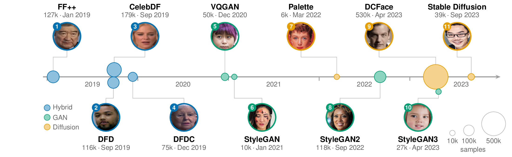
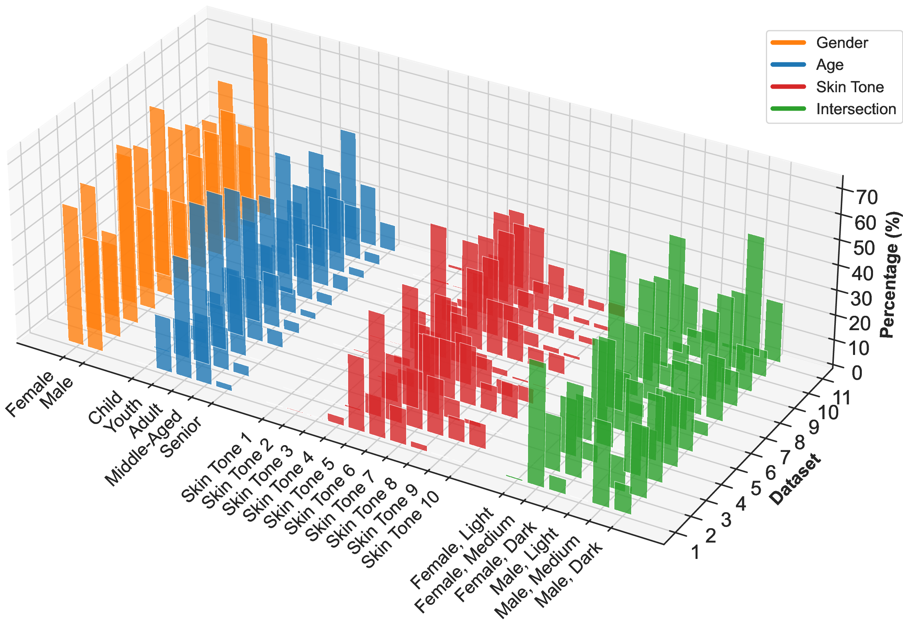
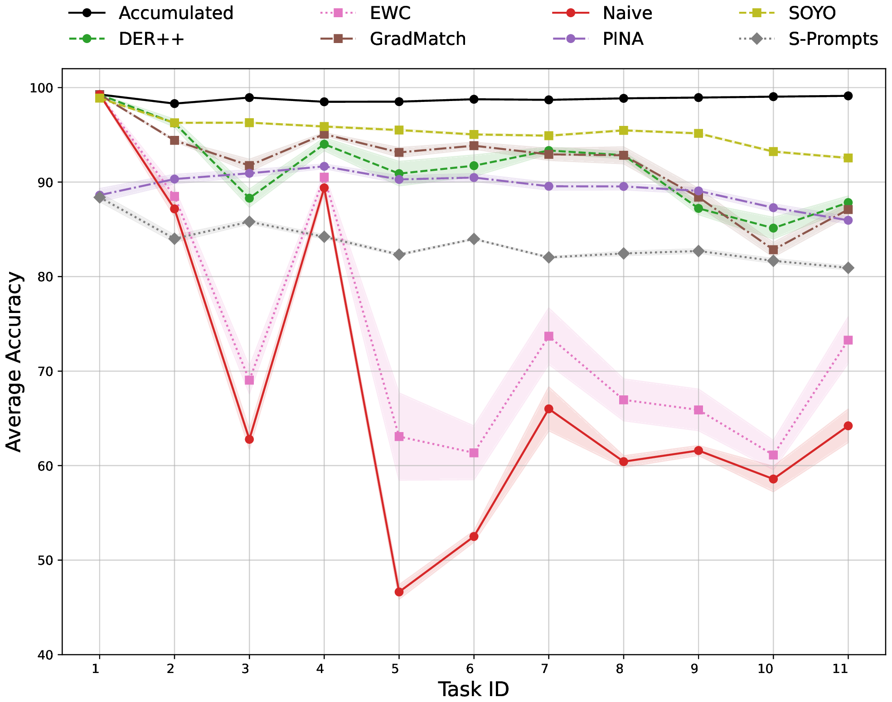
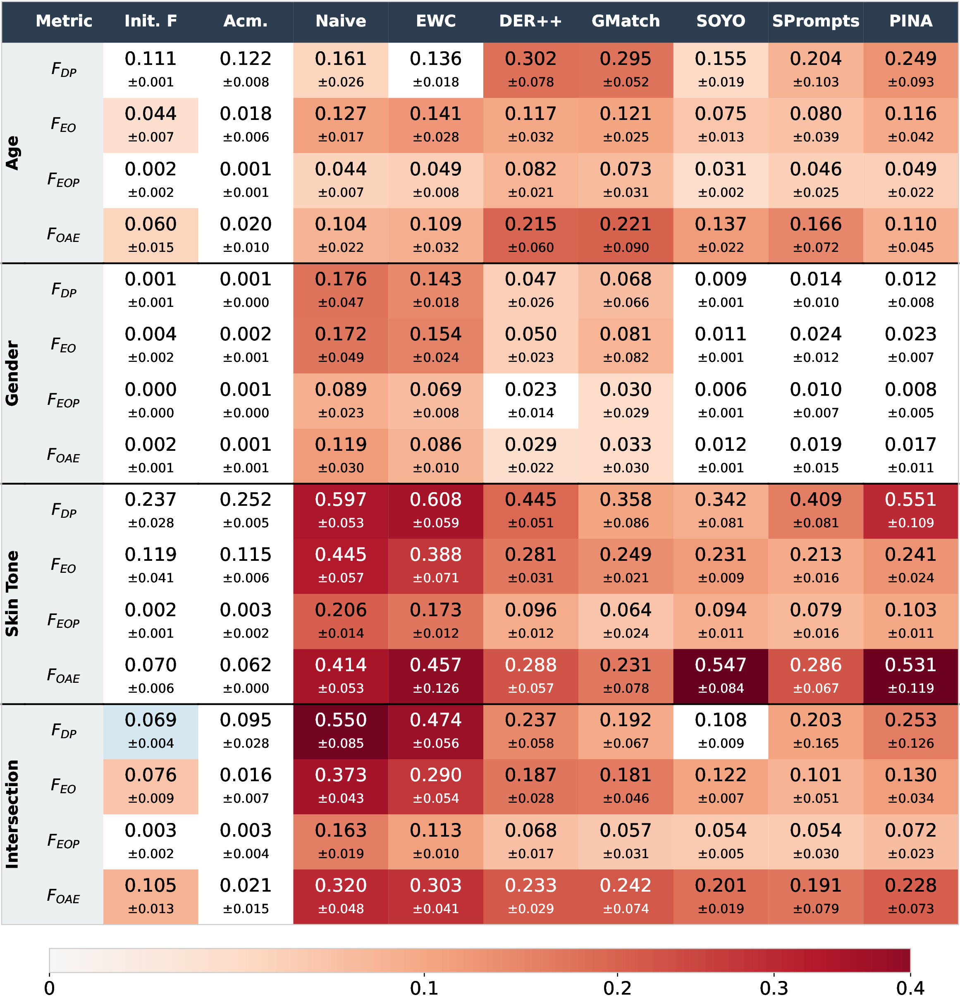
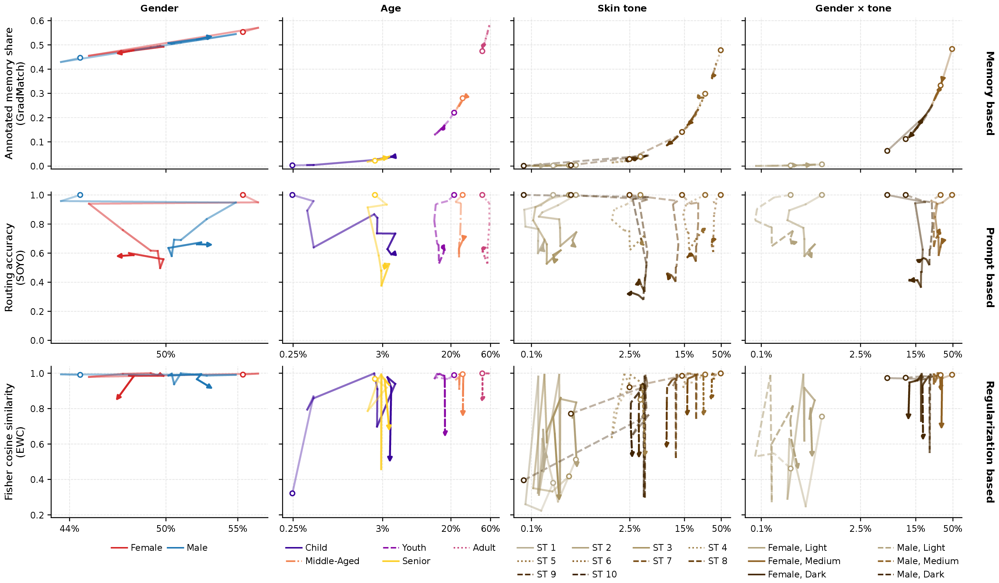

# Time to Fake It: Continual Machine Learning Intensifies Unfairness in Deepfake Detection

**Kajaree Das, Oliver Böse, Subarnaduti Paul, Gabriel Storch, Martin Mundt**<br>
University of Bremen

[[Paper (arXiv)]](https://arxiv.org/pdf/2610.21974) · [[Citation]](#citation)

Official code for training continual-learning deepfake detectors on a chronological sequence of 11 generators and tracking their accuracy and demographic fairness over time.

<p align="center">
  
</p>

*Our chronological sequence of 11 Deepfake datasets, on which a single detector is trained continually. Each task shows its index, the generator, size ($k$ = thousands), date and an example image. Beads mark publication dates; bead area is proportional to dataset size and color denotes the generator family. Fairness is evaluated on demographic test annotations after every training step, but training only ever uses real/fake labels.*

## Contents

- [Abstract](#abstract)
- [Highlights](#highlights)
- [Benchmark](#benchmark-a-chronology-of-deepfake-datasets)
- [Experimental setup](#experimental-setup)
- [Main results](#main-results)
- [Installation](#installation)
- [Data](#data)
- [Training](#training)
- [Fairness tables and figures](#fairness-tables-and-figures)
- [Fisher similarity analysis](#fisher-similarity-analysis)
- [Analysis plots](#analysis-plots)
- [Citation](#citation)
- [Contact](#contact)

## Abstract

Deepfake detectors safeguard against misinformation, rendering their failures as much a societal as a technical concern. As generators constantly evolve, detectors trained on static datasets miss newly arising threats, while progressive training interferes catastrophically. Yet, mitigating forgetfulness in terms of accuracy, the prevalent focus of continual learning (CL), is insufficient to reflect real-world impact. We therefore scrutinize the effects of CL methods with respect to evolving fairness. To this end, we analyze four dimensions of fairness across diverse demographics for detectors trained progressively on a chronological sequence of 11 real-world deepfake generation methods. Tracking fairness metrics over time, we expose non-trivial interplays between performance and fairness that depend on both the choice of CL algorithm and demographic intersections. We find accuracy degradation to typically exacerbate unfairness and, conversely, fairness improvements to remain scarce over time. Dissecting the CL method families (rehearsal, prompts, regularization), we observe that inequitable forgetting is not explained by underrepresentation alone, but likely entangled with representation learning. We thus issue a call to action for CL methods to take social outcomes into account when balancing the stability-plasticity tradeoff.

## Highlights

- **A chronological task sequence for deepfake detection.** 11 real-world deepfake datasets from 2019 to 2023 (face swapping, GANs, diffusion), ordered by public release and annotated with gender, age and skin tone.
- **Fairness and accuracy tracked over time.** Four fairness metrics across gender, age, skin tone and their intersection, after every training step. Compared methods: regularization (EWC), replay (DER++, GradMatch) and prompts (S-Prompts, PINA, SOYO).
- **Knowledge Retention does not mean maintaining fair outcomes.** SOYO, DER++ and GradMatch retain most accuracy, yet every CL method ends up less fair than before continual training. For age, all six CL methods are even less fair in overall accuracy equality than naive fine-tuning. Test sets with little forgetting can show the largest fairness drops. Fairness metrics can also disagree: groups get flagged as fake at more similar rates while accuracy gaps between them widen.
- **Under representation alone does not explain unfairness.** Replay buffers mirror the data's demographic mix. But prompt routing fails most often for darker skin tones despite their larger share, and EWC protects some rare subgroups better than common ones.

## A chronology of deepfake datasets

The tasks are built from [AI-Face-FairnessBench](https://github.com/purdue-m2/ai-face-fairnessbench) (Lin et al., 2025) and ordered by the public release date of each dataset. The figure on the right shows the demographic make-up of each task's test set.

<table>
  <tr>
    <td valign="top" width="38%">
      <table>
        <tr><th>#</th><th>Dataset / generator</th><th>Family</th><th>Released</th></tr>
        <tr><td>1</td><td>FaceForensics++</td><td>Hybrid</td><td>Jan 2019</td></tr>
        <tr><td>2</td><td>DFD</td><td>Hybrid</td><td>Sep 2019</td></tr>
        <tr><td>3</td><td>CelebDF</td><td>Hybrid</td><td>Sep 2019</td></tr>
        <tr><td>4</td><td>DFDC</td><td>Hybrid</td><td>Dec 2019</td></tr>
        <tr><td>5</td><td>VQGAN</td><td>GAN</td><td>Dec 2020</td></tr>
        <tr><td>6</td><td>StyleGAN</td><td>GAN</td><td>Jan 2021</td></tr>
        <tr><td>7</td><td>Palette</td><td>Diffusion</td><td>Mar 2022</td></tr>
        <tr><td>8</td><td>StyleGAN2</td><td>GAN</td><td>Sep 2022</td></tr>
        <tr><td>9</td><td>DCFace</td><td>Diffusion</td><td>Apr 2023</td></tr>
        <tr><td>10</td><td>StyleGAN3</td><td>GAN</td><td>Apr 2023</td></tr>
        <tr><td>11</td><td>Stable Diffusion</td><td>Diffusion</td><td>Sep 2023</td></tr>
      </table>
    </td>
    <td valign="middle" width="62%">
      
      <br>
      <em>Demographic distribution across the 11 test sets. Colors denote disjoint attributes, each summing to 100\%; green shows binary gender intersected with three skin-tone groups (of ten). Some groups are underrepresented throughout (e.g.~very light skin tones), while others fluctuate heavily over time.</em>
    </td>
  </tr>
</table>

## Experimental setup

- **Methods.** Naive sequential fine-tuning and accumulated training as lower and upper bounds, plus EWC (regularization), DER++ and GradMatch (replay), and S-Prompts, PINA and SOYO (prompts). All use a ViT-B/16 backbone pretrained on ImageNet.
- **Training.** Binary real/fake classification on one task at a time. Demographic labels are never used for training.
- **Evaluation.** Accuracy and four fairness metrics: demographic parity (F<sub>DP</sub>), equal opportunity (F<sub>EOP</sub>), equalized odds (F<sub>EO</sub>) and overall accuracy equality (F<sub>OAE</sub>). They're computed over gender, age, skin tone (Monk scale) and gender × skin tone after every task. Results are averaged over five seeds.

Each method maps to one launcher name (see [Training](#training)):

| Method | Family | Launcher name | Training script |
| --- | --- | --- | --- |
| Naive fine-tuning | Lower bound | `naive` | [`src/train_cl.py`](src/train_cl.py) |
| Accumulated training | Upper bound | `accumulated` | [`src/train_cl.py`](src/train_cl.py) |
| EWC | Regularization | `ewc` | [`src/train_cl.py`](src/train_cl.py) |
| DER++ | Replay | `derpp` | [`src/train_cl.py`](src/train_cl.py) |
| GradMatch | Replay | `grad_match` | [`src/train_cl.py`](src/train_cl.py) |
| S-Prompts | Prompts | `sprompts` | [`src/train_prompts_cl.py`](src/train_prompts_cl.py) |
| PINA | Prompts | `pina` | [`src/train_prompts_cl.py`](src/train_prompts_cl.py) |
| SOYO | Prompts | `soyo` | [`src/train_prompts_cl.py`](src/train_prompts_cl.py) |

## Main results

### 1. Most CL methods keep accuracy over the sequence

<p align="center">
  
</p>

*Average accuracy on all tasks seen so far, after training on each generator (mean over five seeds, shading = std). Naive fine-tuning drops to 46.6% at task 5. Accumulated training stays near 99%. SOYO ends at about 93%, and DER++ and GradMatch at about 88%.*

### 2. Fairness degrades, often beyond naive fine-tuning

<p align="center">
  
</p>

*Unfairness on the first generator's test set after training on all 11 generators, per demographic attribute and metric (0 = parity; mean ± std over five seeds). "Init. F" is the fairness right after training on that first generator. Accumulated training largely keeps it. All other methods widen the gaps, and for skin tone SOYO (0.547) and PINA (0.531) end with larger accuracy gaps than naive fine-tuning (0.414).*

### 3. Under-representation is only part of the story

<p align="center">
  
</p>

*Each line follows one demographic subgroup over tasks 1 → 11 (circle → arrow), plotted against its cumulative share of the training data (log scale). Top: share of GradMatch's replay buffer, which follows the data share. Middle: how often SOYO routes a subgroup's samples to the correct task prompt; darker skin tones (ST 8–10) fall below 50% despite larger shares. Bottom: similarity between each subgroup's and the full task's EWC parameter importance; Female × Dark (≈12% share) is better protected than Female × Medium (≈34%).*

## Installation

### Requirements

- Python **3.11 or newer** (declared in [`pyproject.toml`](pyproject.toml))
- [uv](https://docs.astral.sh/uv/) for environment and dependency management
- A CUDA-capable PyTorch installation for training. CPU-only execution is not the intended training configuration.

All Python dependencies are declared in [`pyproject.toml`](pyproject.toml), including PyTorch, torchvision, pandas, NumPy, SciPy, matplotlib, seaborn, timm, transformers, scikit-learn, and Weights & Biases.

### Setup with uv

Run all commands from the repository root.

1. Clone the repository:

   ```bash
   git clone https://github.com/OWL-ML/time-to-fake-it.git
   cd time-to-fake-it
   ```

2. Install uv if it is not already available. See the [uv installation guide](https://docs.astral.sh/uv/getting-started/installation/).

3. Create the environment and install the locked project dependencies:

   ```bash
   uv sync
   ```

   > [!WARNING]
   > On Linux, `torch` and `torchvision` are installed from the PyTorch **CUDA 12.8** index (`pytorch-cu128` in [`pyproject.toml`](pyproject.toml)). Your NVIDIA driver must support CUDA 12.8 or newer. Check the `CUDA Version` shown by `nvidia-smi`, which is the newest CUDA version the driver supports. If it is lower than 12.8, or you want a different build, change both the index `name` and `url` under `[tool.uv.sources]` / `[[tool.uv.index]]` to a build your driver supports (PyTorch 2.9 offers `cu126`, `cu128` and `cu130`, e.g. `https://download.pytorch.org/whl/cu126`), then re-lock and sync:
   >
   > ```bash
   > uv lock
   > uv sync
   > ```
   >
   > macOS uses the default PyPI builds and is not affected.

   This creates/updates `.venv` using `uv.lock`. To include a new dependency, update `pyproject.toml` and run:

   ```bash
   uv add <package>
   ```

4. Check that the environment is usable:

   ```bash
   uv run python --version
   uv run python -c "import torch; print(torch.__version__, torch.cuda.is_available())"
   ```

5. Configure local paths and optional experiment settings in a `.env` file in the repository root (see [`.env.example`](.env.example)). The training launcher loads this file when present. At minimum, set the dataset location:

   ```bash
   DATASET_DIR=/absolute/path/to/ai_face
   CUDA_VISIBLE_DEVICES=0
   ```

   Environment variables supplied on the command line override values loaded from `.env` in `run_training.sh`. Do not commit local paths, API keys, or credentials.

## Data

<!-- TODO: how to obtain AI-Face-FairnessBench and the external real-image sets (CelebA, MetFaces, CASIA-WebFace). -->

The tasks are built from [AI-Face-FairnessBench](https://github.com/purdue-m2/ai-face-fairnessbench), with additional real images from [CelebA](https://mmlab.ie.cuhk.edu.hk/projects/CelebA.html), [MetFaces](https://github.com/NVlabs/metfaces-dataset) and [CASIA WebFaces](https://github.com/deepinsight/insightface). The training scripts expect one folder per task under `DATASET_DIR`, each split into `train/`, `val/` and `test/` with one subfolder per class:

```text
$DATASET_DIR/
├── ff++/
│   ├── train/{fake,real}/
│   ├── val/{fake,real}/
│   └── test/{fake,real}/
├── dfd/
├── celebdf/
├── dfdc/
├── VQGAN/
├── STYLEGAN/
├── Palette/
├── StyleGAN2/
├── DCFACe/
├── stylegan3/
└── StableDiffusion/
```

The folder names above are the task names used in the code, listed in training order.

The demographic annotations (predicted gender and age, Monk skin tone, skin-tone group and gender × skin-tone intersection) are only used for evaluation and analysis. They are provided per task and split in [`metadata/`](metadata) as `metadata/<split>/<task>.csv`.

The scripts read one combined CSV per split, `metadata/train.csv`, `metadata/val.csv` and `metadata/test.csv`. These files are not in the repository. `run_training.sh` and `run_fisher.sh` build any missing ones automatically with [`src/utils/join_metadata.py`](src/utils/join_metadata.py), which also marks the images from sources without annotations (CelebA, MetFaces, CASIA) as `-1` (missing). To build them by hand, for example before running the plotting scripts:

```bash
uv run src/utils/join_metadata.py
```

The training scripts always attach the annotations from these files (paths and columns are set in [`src/utils/constants.py`](src/utils/constants.py)), and the analysis/plotting scripts default to `metadata/train.csv`.

## Expected inputs and generated artifacts

| Task | Required input | Main output |
| --- | --- | --- |
| Baseline training | Dataset at `DATASET_DIR` | `logs/runs/` and training artifacts<br>produced by `src/train_cl.py` |
| Prompt-based training | Dataset plus optional<br>demographic CSVs | `logs/runs/` and prompt-training artifacts<br>produced by `src/train_prompts_cl.py` |
| Fairness tables/figures | `fairness_metrics/<method>/seed_run_<seed>/`<br>`fairness_group.csv` | `fairness_merged/`, `figures/` |
| Buffer heatmaps | `buffer_analysis/csv/representation.csv`,<br>`replay_and_eviction.csv` | chosen plot root under `buffer/` |
| Fisher similarity | EWC checkpoints in `checkpoints/ewc/seed_run_<seed>/`<br>and `metadata/train.csv` | `results/consistency/`, logs in `logs/fisher/` |
| Routing heatmaps | three `routing_analysis/csv/routing_*.csv` files | chosen plot root under `routing/` |
| Trajectories | buffer/routing/Fisher analysis files and<br>`metadata/train.csv` | chosen plot root under `trajectories/` |

## Training

All methods are launched with [`run_training.sh`](run_training.sh), which picks the training script from the method name and uses `uv run` internally. It runs on a single GPU (`0` by default). Seeds may be space- or comma-separated, and `BATCH_SIZE` and `MODEL_NAME` can be overridden for every method. See the variable list at the top of [`run_training.sh`](run_training.sh) for all overrides.

### Baseline continual-learning methods

`naive`, `accumulated`, `ewc`, `derpp`, and `grad_match` run [`src/train_cl.py`](src/train_cl.py):

```bash
./run_training.sh naive
./run_training.sh ewc
./run_training.sh derpp
./run_training.sh grad_match
./run_training.sh accumulated
```

The default seed is `777`.

Useful overrides:

```bash
# Multiple single-GPU runs, one per seed
SEEDS="42 123 777" CUDA_VISIBLE_DEVICES=0 ./run_training.sh naive

# Tune method/run parameters
BATCH_SIZE=64 LAMBDA_EWC=5 ./run_training.sh ewc
ALPHA=0.8 BETA=0.5 REPLAY_SIZE=64 CAPACITY=1500 ./run_training.sh derpp
```

`START_TASK` is also supported.

### Prompt-based continual-learning methods

`sprompts`, `soyo`, and `pina` run [`src/train_prompts_cl.py`](src/train_prompts_cl.py):

```bash
./run_training.sh sprompts
./run_training.sh soyo
./run_training.sh pina
```

The default seed is `42`; provide multiple seeds with:

```bash
SEEDS="42 123 777" ./run_training.sh soyo
```

To run evaluation without training:

```bash
EVAL_ONLY=true ./run_training.sh soyo
```

The method hyperparameters are defined in the launcher; review them before producing final experimental results.

## Fairness tables and figures

[`make_all_tables.sh`](make_all_tables.sh) merges available fairness CSVs and renders the fairness-table figure variants.

```bash
# Generate every configured variant with every available method
./make_all_tables.sh

# Inspect the exact Python command without writing output
./make_all_tables.sh --dry-run

# Only selected figure type(s): diff, algs, bars, or all
./make_all_tables.sh --figures algs

# Limit the datasets used for algorithm tables
./make_all_tables.sh --ds 1 3

# Limit methods and additionally generate one result set per seed
./make_all_tables.sh --methods naive derpp soyo --per-seed
```

The script only includes methods that have a `fairness_group.csv` below `fairness_metrics/<method>/seed_run_*/`. Main outputs go to `fairness_merged/main` and `figures/main`; `--per-seed` adds `seed_<seed>` subdirectories.

## Fisher similarity analysis

[`run_fisher.sh`](run_fisher.sh) runs [`src/evaluations/fisher_evolution_pipeline.py`](src/evaluations/fisher_evolution_pipeline.py) on the EWC checkpoints from `./run_training.sh ewc`. For each demographic subgroup of a task's training data, it computes the empirical Fisher diagonal and compares it with the Fisher of the whole task (cosine similarity, L1 distance and symmetrized KL). This is the EWC panel of the under-representation analysis in [Main results](#3-under-representation-is-only-part-of-the-story).

```bash
# Default: last checkpoint, each dataset's subgroups vs. that dataset's own Fisher
./run_fisher.sh

# Same, but against the Fisher of the last dataset (StableDiffusion)
./run_fisher.sh fisher_sim_last_all_datasets_global

# One dataset across checkpoints 1..11
DATASET_NAME=ff++ ./run_fisher.sh single_dataset_over_time
```

The launcher runs one job per seed (`SEEDS`, default `42 123 777 2024 3407`) on a CUDA GPU and writes one CSV per seed to `results/consistency/`. Once all five seed CSVs are there, they are merged into `empirical_fisher_<local|global>_distances_merged.csv`. `make_all_plots.sh --plots trajectories` uses the local one for the Fisher panel. Other overrides include `BATCH_SIZE` (default `360`), `CHECKPOINT_DIR`, `OUT_DIR`, `DATASETS` and `KEEP_MISSING`.

To re-run only some datasets and replace them in an existing merged CSV:

```bash
DATASETS="VQGAN Palette DCFACe" OUT_DIR=results/consistency_fix \
MERGE_INTO=results/consistency/empirical_fisher_local_distances_merged.csv \
./run_fisher.sh
```

## Analysis plots

[`make_all_plots.sh`](make_all_plots.sh) runs the maintained plotting suites:

```bash
# Buffer heatmaps, routing heatmaps, full trajectories, average accuracy, and heatmaps
./make_all_plots.sh

# Show commands and validate selected inputs without generating figures
./make_all_plots.sh --dry-run

# Run only selected suites
./make_all_plots.sh --plots buffer routing
./make_all_plots.sh --plots trajectories

# Generate only the combined trajectory grid
./make_all_plots.sh --plots trajectories-grid

# Choose analysis inputs and an output root
./make_all_plots.sh \
  --buffer-dir buffer_analysis \
  --routing-dir routing_analysis \
  --metadata metadata/train.csv \
  --out-dir figures_paper
```

Available plot suite names are:

- `buffer` — buffer composition, replay, and related heatmaps.
- `routing` — routing-error, checkpoint, and destination heatmaps.
- `trajectories` — individual trajectory figures plus the combined grid.
- `trajectories-grid` — only the combined trajectory grid (`--grid-only`).
- `average-accuracy` — average-accuracy comparison plot.
- `heatmap` — task-accuracy heatmap.
- `all` — the default selection; it runs every suite except the redundant `trajectories-grid`-only command.

The buffer, routing, and trajectory suites are written under `<out-dir>/buffer`, `<out-dir>/routing`, and `<out-dir>/trajectories` (default: `figures_plots/`). The legacy `average-accuracy` and `heatmap` scripts retain their own `metrics/` input and `plots/` output locations.

## Notes

- Run launcher and generation scripts from the repository root so their relative paths resolve correctly.
- All shell scripts use `set -euo pipefail`; a missing required input stops the command instead of silently creating partial output.
- Start with `--dry-run` for table and plot generation when using a new result directory.
- Training logs are written under `logs/runs/` with the method, seed, timestamp, and Git revision reported by the launchers.

## Citation

If you find this work useful, please cite:

```bibtex
@article{das2026timetofakeit,
  title   = {Time to Fake It: Continual Machine Learning Intensifies Unfairness in Deepfake Detection},
  author  = {Das, Kajaree and B{\"o}se, Oliver and Paul, Subarnaduti and Storch, Gabriel and Mundt, Martin},
  journal = {arXiv preprint arXiv:2610.21974},
  year    = {2026}
}
```

## Contact

Kajaree Das (dask@uni-bremen.de) and Martin Mundt (mundtm@uni-bremen.de)
